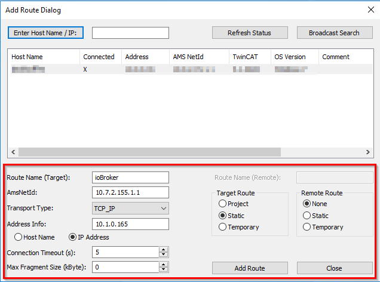

# ioBroker.beckhoff

 

 
**Version:**  

 
**Tests:**  

<!--
## Sentry
**This adapter uses Sentry libraries to automatically report exceptions and code errors to the developers.**
For more details and for information how to disable the error reporting see [Sentry-Plugin Documentation](https://github.com/ioBroker/plugin-sentry#plugin-sentry)! Sentry reporting is used starting with js-controller 3.0.
-->

## BECKHOFF Adapter for ioBroker

This adapter for ioBroker can Communicate with a Beckhoff Automation System (Twincat 2 or 3) over the ADS Protocol.
The ADS Protocol is implemented in every System of Beckhoff and can be used without any License on ioBroker or Automation System.

This Project is not affilate to Beckhoff in any way

## Description

### Requirements

- Beckhoff PLC that has an ethernet connection and is connected to your LAN
  - Make your you give the PLC a fixed IP address
  - Make sure you can ping the PLC from ioBroker
  - TwinCat 2 **excluding BC Runtimes** or TwinCat 3

### PLC Configuration

1. Enable ADS on your PLC project. To do this click on your task and then enable the checkbox before `Create symbols`. Download the new configuration and make sure you reboot your PLC. The reboot is only needed when you are using TwinCat 2.

   

2. Now add a static route to our Beckhoff PLC. The route should point to your server that will run the proxy application.

   Here an example to add a Static Route directly on PLC u can add this Route also from your EngineeringPC to the PLC.

   

   Important is that the AmsNetId and the AdressInfo (IP-Adress) matches with the Adapter Settings. For further Information about TwinCat Router and Security read Documentation on Synchronisierung [Beckhoff Information System](https://infosys.beckhoff.com/ 'Beckhoff Information System')

3. On TwinCat 2 Create a Struct and fill in your needed Symbols. Then add this Struct to a GlobalVariableTable.

   ##### Currently Supported Types: BOOL, BYTE, WORD, DWORD, SINT, USINT, INT, UINT, DINT, UDINT, REAL, LREAL, TIME, TIME_OF_DAY, TOD, DATE, DATE_AND_TIME, DT, STRING

   OPTIONAL: You can create a Variable in root of Struct with the exact name -> ioBrokerResync (Not Casesensitiv and not matter which Type) -> Every time this Variable changes his value the Table get resynced in ioBroker.

4. On TwinCat 3 Create a GlobalVariableTable and fill in your needed Symbols.

   ##### Currently Supported Types: BOOL, BYTE, WORD, DWORD, SINT, USINT, INT, UINT, DINT, UDINT, REAL, LREAL, TIME, TIME_OF_DAY, TOD, DATE, DATE_AND_TIME, DT, STRING

   OPTIONAL: You can create a Variable in root of Variable Table with the exact name -> ioBrokerResync (Not Casesensitiv and not matter which Type) -> Every time this Variable changes his value the Table get resynced in ioBroker.

### Adapter Configuration

#### Twincat 3 and Twincat 2

1. Choose your Runtime Version
2. Fill in the target IP address or hostname and AMS-Net-ID.
3. On TwinCat 2 fill in the Instance Name of Struct.
4. On TwinCat 3 fill in the correct Tablename of the before created GlobalVariableTable.
5. All other Points u mostly not need to Change.

#### Twincat 2 <= v2.11.2240

Upload your \*.tpy File from your PLC Project -> Every Time you change something on the Struct u communicate with the ioBroker, you need to Upload it again.

### Dataexchange

- When some Value is changed in PLC then it will be automatic transferred to ioBroker
- When a Value is changed in ioBroker (Important: ACK need to be FALSE!!) then the Value will be automatic transferred to PLC. After that the Adapter set ACK to TRUE.

### Attention

1. TwinCAT AMS Router doesn't allow multiple TCP connections from the same host. So when you use two instances on the same host to connect to the same TwinCAT router, you will see that TwinCAT will close the first TCP connection and only respond to the newest.
2. A full metadata synchronization runs on adapter startup, on symbol-version changes, after an observed PLC STOP/RUN transition, and when `ioBrokerResync` changes.
3. A reconnect after a short network outage can reuse symbol names and data types. ADS handles and notifications are recreated, and current PLC values are read again. Object IDs and user-defined mappings are preserved.

### Connection settings

- **ADS request timeout (ms)** (`adsTimeout`, default **500**): timeout for each ADS request. For slow or VPN connections, try **2000**. This does not change the reconnect interval.
- **Interval for reconnect** (`reconnectInterval`, default **15 seconds**): delay between connection attempts and interval for PLC-state/acknowledgement checks.
- **Reuse symbol metadata after short outages** (`cacheSymbolTable`, default **true**): keeps an in-memory metadata cache for the same configured PLC and variable table. A new adapter process always performs a full synchronization.
- **Maximum outage for symbol cache** (`symbolCacheMaxAge`, default **300 seconds**): longer outages require a full synchronization. Set to zero or disable caching to always reload metadata.

The cache is checked against the ADS symbol version before and after registration. Version changes, observed PLC stops, failed cached subscriptions/reads and explicit resync requests trigger a full synchronization. A missing write acknowledgement only refreshes current values; it does not download symbol metadata or replay PLC writes.

The ADS symbol version is an 8-bit counter, not a unique PLC boot/program identifier. A PLC restart or counter wrap during an unobserved outage can reuse the same number. For installations where this can occur, disable caching or maintain a PLC `ioBrokerResync` counter that changes on startup/program changes. The outage limit reduces reuse after long gaps; it cannot prove program identity.

### Legacy TPY files

For TwinCAT 2 <= v2.11.2240, upload and select a `.tpy` file in the configuration UI. Files are stored under `beckhoff.<instance>.tpy` and are read on adapter startup. The existing `xmlTpyData` configuration remains supported: clear the file selection to use or edit the existing XML contents. A selected file takes precedence. Upload a new TPY file whenever the PLC symbol definitions change.

Existing TPY files are copied into the named `tpy/` directory at startup. Originals remain available, and differing existing files are never overwritten. The configuration dialog maps an old selection to its managed copy; saving the settings persists that path. Upload, file listing and selected values now use the same directory. The adapter continues to support existing saved paths.

### Development validation

Use Node.js 22 or newer. Development tools require Node.js >=22.19.0. The standard CI tests Node.js 22, 24 and 26 on Linux, Windows and macOS. Run `npm ci`, `npm test`, `npm run check`, `npm run lint` and `npm run test:integration`. The connection regression tests use simulated ADS clients and never control a real PLC. Successful startup/CI tests do not replace validation against the target TwinCAT runtime.

## Changelog
<!--
    Placeholder for the next version (at the beginning of the line):
    ### **WORK IN PROGRESS**
-->
### 2.0.0 (2026-10-19)
- (copilot) Adapter requires node.js >= 22 now
- (copilot) Adapter requires admin >= 7.7.22 now
- (zonfacter) Reuse validated symbol metadata after short reconnects, renew ADS handles and refresh values; fully synchronize on metadata changes, observed PLC stops or expired caches
- (zonfacter) Add a configurable ADS request timeout and hostname support; preserve variable-table prefix matching and existing object mappings
- (zonfacter) Migrate to responsive jsonConfig with native TPY upload, persistent filename feedback and packaged translations; retain legacy XML and TPY paths
- (zonfacter) Prepare a named TPY file directory without removing originals or overwriting differing files; support configuration requests through supportedMessages.custom
- (zonfacter) Isolate compact-mode sessions, reject stale callbacks and avoid a metadata reload when only a write acknowledgement is missing
- (zonfacter) Fix synchronization when a metadata notification arrives during the final connection-state write
- (mcm1957) Dependencies have been updated

### 1.7.0 (2026-02-12)
- (mcm1957) Adapter requires node.js >= 20 now
- (copilot) Adapter requires js-controller >= 6.0.11 now
- (copilot) Adapter requires admin >= 7.6.17 now
- (copilot) Migrated to ESLint 9 and @iobroker/eslint-config standard configuration
- (mcm1957) Dependencies have been updated

### 1.6.0 (2024-04-02)

* (mcm1957) Adapter requires node.js 18 and js-controller >= 5 now
* (mcm1957) Dependencies have been updated

### 1.5.3 (2023-10-29)

- (mcm1957) Dependencies have been updated

### 1.5.3-alpha.0 (2023-10-29)

- (mcm1957) Standard test environment has been updated

[Older changelogs can be found there](CHANGELOG_OLD.md)

## License

The MIT License (MIT)

Copyright (c) 2024-2026 iobroker-community-adapters <iobroker-community-adapters@gmx.de>  
Copyright (c) 2018-2023 dkleber89 <dkleber89@gmail.com>

Permission is hereby granted, free of charge, to any person obtaining a copy
of this software and associated documentation files (the "Software"), to deal
in the Software without restriction, including without limitation the rights
to use, copy, modify, merge, publish, distribute, sublicense, and/or sell
copies of the Software, and to permit persons to whom the Software is
furnished to do so, subject to the following conditions:

The above copyright notice and this permission notice shall be included in
all copies or substantial portions of the Software.

THE SOFTWARE IS PROVIDED "AS IS", WITHOUT WARRANTY OF ANY KIND, EXPRESS OR
IMPLIED, INCLUDING BUT NOT LIMITED TO THE WARRANTIES OF MERCHANTABILITY,
FITNESS FOR A PARTICULAR PURPOSE AND NONINFRINGEMENT. IN NO EVENT SHALL THE
AUTHORS OR COPYRIGHT HOLDERS BE LIABLE FOR ANY CLAIM, DAMAGES OR OTHER
LIABILITY, WHETHER IN AN ACTION OF CONTRACT, TORT OR OTHERWISE, ARISING FROM,
OUT OF OR IN CONNECTION WITH THE SOFTWARE OR THE USE OR OTHER DEALINGS IN
THE SOFTWARE.
